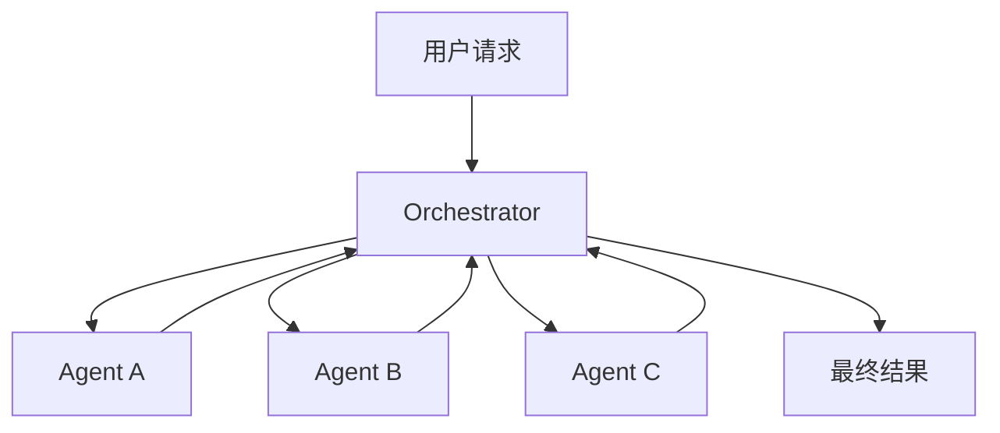
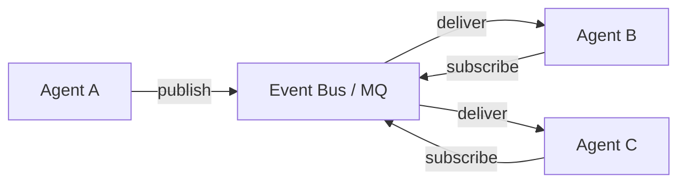
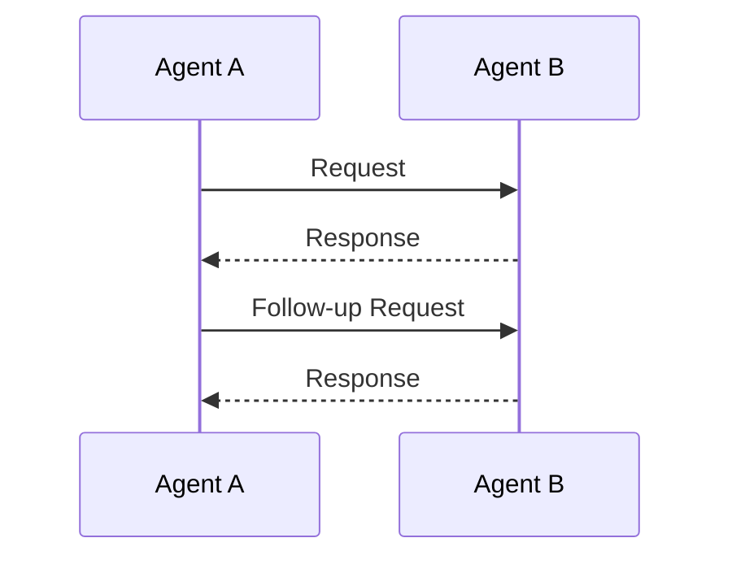
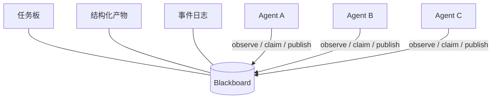

# 多 Agent 项目中的子 Agent 通信

这篇文章回答两个问题：

1. 多 Agent 项目里，子 Agent 到底怎么通信？
2. CareTrace 属于哪种通信形式？

## 1. 先说结论：Agent 之间通常不应该直接聊天

如果把两个子 Agent 的通信理解成“Agent A 用自然语言问 Agent B，B 再用自然语言回 A”，开发起来最直观，但生产系统里问题很多：

- 自然语言有歧义，下游 Agent 容易误解上游意图。
- 调用关系容易变成硬编码链路：A 固定调用 B，B 固定调用 C，后续扩展困难。
- 中间结果没有稳定结构，难以审计、重放、评估和调试。
- 一旦出现循环调用、重复执行或失败重试，很难判断是哪一步造成的。

所以成熟的多 Agent 系统一般不会让 Agent 自由聊天，而是让它们通过明确的协议交换结构化消息或结构化产物。

一个常见的结构化消息大致包含这些字段：

```json
{
  "message_id": "msg_01",
  "trace_id": "turn_123",
  "sender": "UnderstandingAgent",
  "receiver": "CoordinatorAgent",
  "type": "ARTIFACT_PUBLISHED",
  "payload": {
    "intent": "CONSULT",
    "confidence": 0.92
  },
  "created_at": "2026-08-23T10:00:00+08:00"
}
```

在偏“共享状态”的系统里，`receiver` 可能不存在，或者只是一个逻辑目标。因为 Agent 并不直接把消息投递给另一个 Agent，而是把结果发布到公共空间，其他 Agent 根据任务和规则来读取。

## 2. 四种常见通信模式

### 2.1 Orchestrator / 中央调度模式

所有子 Agent 不直接决定全局流程。一个协调者负责拆解任务、分配任务、收集结果、处理失败和决定最终输出。

流程通常是：



**特点**

- 控制流集中在 Coordinator / Orchestrator。
- 子 Agent 通常只暴露统一接口，例如 `act(task, context)` 或 `execute(request)`。
- 全局预算、超时、优先级、最终验收都更容易实现。

**优点**

- 流程清晰，容易追踪。
- 容易做权限控制和安全门禁。
- 最终输出责任明确。

**缺点**

- 协调者可能成为复杂度和单点瓶颈。
- 如果协调者把所有业务分支都写死，会退化成普通工作流引擎。

**适用场景**

适合需要明确审批链、安全审核、预算控制和最终验收的业务系统。

### 2.2 Pub/Sub / Event Bus / 消息队列模式

Agent 发布事件到总线，其他 Agent 订阅自己关心的事件。发布者不需要知道订阅者是谁。

流程通常是：



**特点**

- 生产者和消费者解耦。
- 常见载体包括 Kafka、RabbitMQ、Redis Pub/Sub、NATS，或者进程内的 EventBus。
- 天然适合异步任务、跨服务协作和事件溯源。

**优点**

- 扩展新消费者比较容易。
- 服务之间耦合低。
- 可以做异步削峰、重试和事件回放。

**缺点**

- 分布式场景下要额外处理幂等、顺序、重复投递和最终一致。
- 业务流程可能被拆散到多个订阅者里，端到端追踪变难。
- 小型单体项目引入外部 MQ 可能过重。

**适用场景**

适合异步长任务、跨服务多 Agent、需要事件审计或多团队共同维护的系统。

### 2.3 Agent-to-Agent 点对点模式

Agent A 直接向 Agent B 发送请求，B 返回响应。这里的“直接”不一定意味着网络直连，也可以是运行时里的方法调用或 actor 地址寻址。

流程通常是：



**特点**

- 交互路径短，延迟低。
- 更接近对话式协商、询价、局部仲裁。

**优点**

- 局部协作直观。
- 少量 Agent 之间做短期协商很方便。

**缺点**

- 关系数量会快速增长：2 个 Agent 有 1 条边，5 个 Agent 最多 10 条边。
- 容易形成隐式依赖和循环依赖。
- 全局状态分散在各 Agent 私有上下文里，难以审计。

**适用场景**

适合小规模、强局部协商的场景，例如某个 Agent 向另一个 Agent 请求澄清，或者临时发起一次工具调用授权。

### 2.4 Blackboard / 共享状态模式

多个 Agent 共同读写一块共享黑板。黑板里保存任务、中间产物、消息和事件。某个 Agent 的输出会成为其他 Agent 后续判断的输入。

流程通常是：



**特点**

- Agent 不是互相调用，而是围绕共享状态协作。
- 典型循环是：观察黑板 → 判断是否认领任务 → 执行 → 发布结构化产物 → 其他 Agent 继续处理。

**优点**

- 新增 Agent 只需要声明能力和认领策略，不必改写已有调用链。
- 中间产物集中保存，便于解释和调试。
- 能自然表达“某些结果齐了之后才继续”的协作。

**缺点**

- 共享状态需要版本、冲突、并发写入和生命周期管理。
- 如果黑板变成无结构的大杂烩，很快会失控。
- 需要限制轮数、认领次数和重复产物，否则可能反复生成相似结果。

**适用场景**

适合一轮请求需要多种专家视角、中间产物较多、需要逐步收敛出最终结果的系统。

## 3. 工程上必须补齐的控制机制

无论选择哪种模式，进入生产环境前都需要这些能力。

| 问题 | 常见做法 |
| --- | --- |
| 循环协作 | 限制最大轮数、最大认领次数、最大修订次数 |
| 重复消费 | 消息/事件带唯一 ID，消费逻辑幂等 |
| 失败处理 | 设置超时、重试、降级响应和 fallback agent |
| 可观测性 | 使用 `trace_id` / `turn_id` / `task_id` 贯穿日志、指标和事件 |
| 权限与安全 | 明确哪个 Agent 能读什么、写什么、能否触发外部动作 |
| 结果质量 | 引入评审、验收、置信度阈值或强制安全审核 |
| 并发控制 | 对共享状态加锁、使用不可变更新，或只允许协调者合并结果 |

## 4. CareTrace 是哪种形式？

CareTrace 采用的是事件驱动的多 Agent 架构，但它不是纯 Pub/Sub 系统，也不是 Agent 之间的自由点对点通信。

它的核心形态可以概括为：

> **Orchestrator 式调度 + Blackboard 共享状态协作 + 进程内事件日志驱动。**

相关实现主要在这几个位置：

- [events.py](../app/agents/events.py)：定义 `CollaborationBlackboard`、`AgentTask`、`AgentMessage`、`AgentArtifact` 和 `AgentEvent`。
- [coordinator.py](../app/agents/coordinator.py)：实现 `EventDrivenCoordinator`，负责任务推导、候选认领、执行、结果回写和最终验收。
- [event_driven_runtime.py](../app/agents/event_driven_runtime.py)：组装 Agent、创建黑板并启动整轮协作。
- [autonomous.py](../app/agents/autonomous.py)：定义具体业务 Agent。
- [README.md](../README.md)：提供整体架构说明。

### 4.1 黑板里有什么

`CollaborationBlackboard` 是一次 turn 内的共享协作空间，主要保存：

| 字段 | 含义 |
| --- | --- |
| `tasks` | 当前待处理和已处理的任务 |
| `messages` | Agent 之间的结构化消息 |
| `artifacts` | 各类结构化中间产物 |
| `events` | 追加式事件日志 |
| `conversation_history` / `model_history` | 本轮可用的历史上下文 |
| `memory_brief` | 历史记忆摘要 |
| `final_artifact_id` | 最终被采纳的回复产物 ID |
| `current_round` | 当前协作轮次 |

其中 artifacts 的典型类型包括：

| artifact kind | 说明 |
| --- | --- |
| `intent` | 用户意图理解结果 |
| `risk` | 安全风险等级 |
| `context` | 记忆和知识库检索结果 |
| `response_candidate` / `response_proposal` | 候选回复 |
| `safety_review` | 对候选回复的安全审核 |
| `critique` | 批评或修改建议 |

每个 `AgentArtifact` 都带有 `owner`、`kind`、`payload`、`confidence`、`task_id`、`version` 等字段，因此 Agent 的产出不是一段模糊文本，而是可以被后续 Agent 和 Coordinator 消费的结构化结果。

### 4.2 协作循环怎么跑

CareTrace 的主循环由 `EventDrivenCoordinator.run()` 控制：

1. Coordinator 创建 root task。
2. 进入有限轮次的调度循环。
3. 根据黑板当前缺少哪些 artifact，推导缺失任务。
4. 通过 `AgentRegistry.evaluate_decisions_for()` 让 Agent 决定是否认领任务。
5. 被选中的候选执行自己的任务。
6. Coordinator 把 `AgentTurnResult` 中的 messages、artifacts、follow-up tasks、events 合并回黑板。
7. 再次推导任务，检查是否已经存在可接受的最终回复。
8. 如果最终回复通过验收，结束；如果达到轮数上限仍未接受，记录 `BUDGET_EXHAUSTED` 并走安全兜底。

这个过程里，Agent 之间没有一个固定的“你先调用我、我再调用你”的链路。它们主要是在观察同一个黑板上的任务和产物，然后发布自己的结果。

### 4.3 为什么说它不是纯 Pub/Sub

CareTrace 有大量事件类型，比如：

- `TURN_STARTED`
- `TASK_CREATED`
- `TASK_CLAIMED`
- `TASK_CLOSED`
- `MESSAGE_SENT`
- `ARTIFACT_PUBLISHED`
- `CRITIQUE_PUBLISHED`
- `SAFETY_OVERRIDE`
- `FINAL_ACCEPTED`
- `AGENT_EXECUTION_STARTED`
- `AGENT_EXECUTION_COMPLETED`
- `AGENT_EXECUTION_FAILED`
- `BUDGET_EXHAUSTED`

但这些事件目前保存在 `CollaborationBlackboard.events` 这个追加式列表里，用于本轮协作的状态推进、审计和 trace 输出。它不是 Kafka、RabbitMQ、Redis Pub/Sub 这样的独立分布式消息总线。

更准确地说：

- 它有“事件驱动”的思想；
- 但事件的主要载体是黑板内的 append-only event log；
- 事件的消费发生在同一个进程内的调度循环中；
- 不存在独立的跨进程 broker。

### 4.4 并发和安全如何处理

`EventDrivenCoordinator` 里有一个并行集合：

```python
_PARALLEL_AGENT_NAMES = frozenset({"UnderstandingAgent", "SafetyAgent"})
```

也就是说：

- `UnderstandingAgent` 和 `SafetyAgent` 可以在本地线程池中并行执行；
- `ContextAgent` 和 `ResponseAgent` 这类依赖前序产物的 Agent 按顺序执行；
- 并行执行的结果不会让多个线程同时改黑板，而是先拿到各自的 `AgentTurnResult`，再由 Coordinator 单线程合并回黑板。

安全方面，最终响应必须来自被 Coordinator 接受的候选产物。未通过 `safety_review` 的候选不会被发送给用户。即使预算耗尽，运行时也会使用确定性兜底文案，而不是放行未审核内容。

### 4.5 分类结论

可以把 CareTrace 拆成几层来看：

| 维度 | CareTrace 的选择 |
| --- | --- |
| 主要数据协作方式 | Blackboard / 共享黑板 |
| 控制流 | Orchestrator 式 Coordinator |
| 触发与观测机制 | 事件驱动，但事件保存在黑板内 |
| 局部执行 | Understanding 和 Safety 可有限并行 |
| 外部 MQ / Pub/Sub | 未作为 Agent 主通信通道 |
| Agent 直接自由对话 | 不是主要模式 |

所以，如果只能选一个标签，CareTrace 最准确的分类是：

> **以 Blackboard 为核心、Coordinator 负责调度和验收的事件驱动混合架构。**
