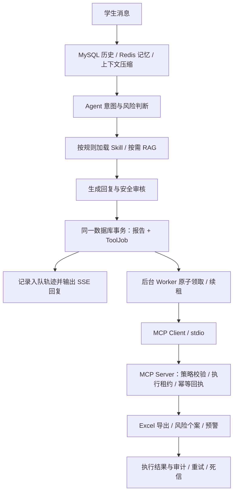

# CareTrace 工具执行流程与面试讲解

## 一条消息到后台预警



默认 `TOOL_QUEUE_ENABLED=true`。MySQL 任务表就是持久化队列；任务和报告同一事务提交，不需要另加消息中间件或第二套任务队列。聊天流中断不会取消已经提交的任务。MySQL 的提交成功是接受后台工作的边界，不能把任务丢到进程内 `asyncio.create_task()` 后就返回成功。

`TOOL_QUEUE_ENABLED=false` 是显式同步兼容模式：仍然经过 MCP，但请求等待工具执行，不具备持久化队列的恢复保证。生产使用默认模式。

## 各技术的职责

| 技术 | 实际承担的职责 | 不应夸大的部分 |
| --- | --- | --- |
| FastAPI / SSE | API、鉴权、输出已审核回复 | SSE 本身不是后台任务队列 |
| MySQL / SQLAlchemy | 会话与报告持久化、事务入队、任务 CAS 领取、幂等唯一键、租约与审计 | 本地事务不能覆盖外部 SMTP 的结果 |
| Redis | 近期与 Agent 私有记忆、MCP 执行入口的共享邮件限流 | 当前队列不使用 Redis，历史优先从 MySQL 读取 |
| Skill | 按意图、风险、主题关键词选取 SKILL.md 并加入上下文 | 是规则选择，不是模型自主安装或执行任意技能 |
| RAG | 检索回答所需的知识依据 | 不承担副作用执行 |
| MCP | Worker 与具体业务工具之间的协议边界 | 不是消息队列；`async def` 不等于持久化异步任务 |
| ThreadPoolExecutor | 限制单 Worker 的并发执行量 | 线程锁不能替代跨进程互斥 |

记忆层使用按用户隔离的核心偏好、相关事实召回、增量摘要和近期原文；最终回答采用字符软预算。详见 [student-memory.md](student-memory.md)，此处不宣称精确 token 计数。

## 关键代码入口

- `app/agents/harness.py`：`_create_report()` 先 flush 报告，再 `enqueue_report(commit=False)`，最后一次 commit；出错整体 rollback。
- `app/services/chat.py`：首个 SSE 事件之前记录任务提交，断连不撤销任务。
- `app/services/tool_queue.py`：领取、续租、执行、退避、恢复和管理员重放。
- `app/services/mcp_client.py`：每个任务建立受超时约束的 stdio 会话，传递 jobId、租约 token 与幂等键；消费结构化结果。
- `app/mcp_tools/server.py`：六个 MCP 工具；业务错误使用 `isError=true`。
- `app/services/tool_execution.py`：统一策略、过期执行拒绝、持久化执行回执与审计。
- `app/services/tool_locks.py`：MySQL 连接级 advisory lock；本地 SQLite 使用跨进程文件锁。
- `app/services/tools.py`：实际 Excel、个案和邮件行为。
- `app/services/tool_rate_limit.py`：Redis Lua 原子固定窗口计数。

stdio MCP 是可信本机服务边界，凭据来自受控进程配置。本实现没有开放远程 HTTP MCP，也没有声称具备多租户远程 OAuth 授权。个案接手/备注工具默认关闭，启用后使用配置的服务身份，不能由调用参数冒充任意辅导员。人工操作优先走已认证的管理接口。

## 任务与幂等

```text
PENDING → RUNNING → SUCCESS / SIMULATED
              ↓
          RETRY_WAIT → RUNNING
              ↓
             DEAD
```

- `EXCEL_REPORT` 独立执行；`CASE_CREATE → ALERT_SEND` 有明确依赖，预警不等待 Excel。
- 报告级提交锁与数据库唯一幂等键防止并发创建重复任务。默认报告为不可变记录，键带 `v1`；将来支持报告编辑时必须引入真实版本号。
- 预警键包含模式与收件人集合，log 演示不会占用 SMTP 的幂等结果。相同键不能被重新解释为不同参数；修改投递配置后应提交新操作，旧任务会拒绝配置不匹配。
- Worker 用条件 UPDATE 领取任务。每次领取有独立租约 token；心跳延长租约；只回收已过期任务。旧执行者不能覆盖新执行者的任务状态。
- `ToolExecutionRecord` 是 MCP 执行回执。响应丢失时重试可返回已有结果。回执与外部副作用间仍可能有崩溃窗口，所以业务操作必须另行防重。
- Excel 在跨进程文件锁内按 reportId 去重，使用临时文件和原子替换，恢复“文件已保存但 DB 未提交”的情况。多主机部署需要共享且支持 flock 的存储，或改为单导出服务/对象存储；不同节点的本地同名路径不是同一文件。
- 邮件在提交 SMTP 前持久化 `SENDING`。中断后不能确定结果时转 `UNKNOWN`，禁止自动重发。这里选择保守处理，不能宣称 exactly-once。

## 邮件状态与失败分类

| 状态 | 含义 |
| --- | --- |
| `SIMULATED` | log 模式记录，无真实邮件，个案仍为 OPEN |
| `SUCCESS` | SMTP 接受了全部收件人，不代表到达收件箱、被阅读或人工接手 |
| `FAILED` | 明确失败，根据 retryable 决定重试或死信 |
| `SENDING` | 已保存发送意图，正在调用 SMTP |
| `UNKNOWN` | 提交结果不确定或部分收件人被拒绝，需要人工核查 |

SMTP 4xx 临时拒绝、连接失败可重试；5xx、缺配置、策略拒绝直接进死信；提交期间断连、部分接受转 UNKNOWN。成功提交后 QUIT 失败不会抹掉已接受结果。模拟邮件不触发 Redis 额度消耗。

Redis 限流使用发送账号级共享 key 和原子 Lua，窗口 60 秒，多 Worker 共享额度。固定窗口边界可能有突发，不等价于滑动窗口。限流或限流服务不可用时延迟重排，不消耗邮件执行重试次数。执行失败使用指数退避和抖动，最多 300 秒的基础延迟。

依赖任务进入 DEAD 后，下游任务也进入 DEAD，不会永久轮询。修复依赖后，管理员先重放依赖再重放下游，操作保留原因和身份审计。

## 迁移与配置

已有数据库升级时，先停止所有应用和 Worker；建议先备份。再运行：

```bash
.venv/bin/python scripts/migrate_tool_queue.py
```

迁移为旧表增加任务租约、幂等键和邮件状态字段，创建回执表及唯一索引。历史重复任务保留并标注 DEAD，依赖指向保留的任务；旧 log 成功记录改成 SIMULATED。MySQL 调度时间采用 DATETIME(6)，避免秒级取整使新任务落到未来。迁移可以重复执行。应用启动会检查关键列，缺列时给出明确迁移提示；MCP 工具调用不执行 DDL。

```env
TOOL_QUEUE_ENABLED=true
TOOL_QUEUE_LEASE_SECONDS=120
TOOL_MCP_TIMEOUT_SECONDS=60
TOOL_LOCK_TIMEOUT_SECONDS=10
TOOL_QUEUE_MAX_ATTEMPTS=3
TOOL_QUEUE_RETRY_DELAY_SECONDS=15
ALERT_EMAIL_DELIVERY_MODE=log
ALERT_RATE_LIMIT_BACKEND=redis
ALERT_EMAIL_RATE_LIMIT_PER_MINUTE=30
MCP_ALLOW_CASE_MANAGEMENT=false
```

使用 Python 3.11+，固定 MCP SDK 1.29.0。当前每个任务启动一个 stdio 服务进程，便于隔离和超时清理；吞吐增加后可改为长驻 MCP 连接池，不能省掉任务租约、结构化错误或幂等校验。

## 观察与故障演示

以下 API 都需要管理员身份：

- `GET /api/admin/tool-jobs`：状态、次数、下次执行时间、traceId、幂等键、结果。
- `GET /api/admin/tool-jobs/{job_id}`：单任务及执行事件、MCP 审计。
- `GET /api/admin/dead-letters`：失败历史。
- `POST /api/admin/tool-jobs/{job_id}/replay`，正文 `{"reason":"已修复 SMTP 配置"}`：只重放 DEAD 任务，保留失败历史。UNKNOWN 投递拒绝直接重放；先核查服务商记录，当前未提供自动 reconciliation。

聊天轨迹只产生 `TOOL_EXECUTION_QUEUED`。Worker 独立写入 STARTED、COMPLETED、SIMULATED、RETRY_SCHEDULED、FAILED 事件，通过 traceId/jobId 关联。聊天回合完成与后台任务完成是两个独立状态。

```bash
.venv/bin/python -m pytest -q
.venv/bin/python -m app.harness.runner --suite tool-queue --json
.venv/bin/python scripts/check_tool_mysql.py
```

pytest 包含实际 stdio MCP、并发提交和领取、过期租约、真实子进程退出、SSE 提前关闭、报告/任务回滚、文件已落盘后恢复、SMTP 错误分类、模拟与真实投递隔离、Redis 共享限流与不可用、旧库迁移和管理员权限。Redis 测试会启动临时本地实例；缺少 redis-server 时明确 skip。MySQL 脚本需要 Docker 和本地 mysql:8.0 镜像，只使用一次性容器和测试数据库，结束后删除容器。测试不发送真实邮件。

## 面试时可以怎样讲

> 我把工具协议和任务调度分开：MCP 统一调用边界，MySQL 任务表提供持久化异步执行。报告和任务同事务保存，后台 Worker 原子领取并续租，通过 MCP 执行经过风险策略校验的工具。结果使用结构化返回和幂等回执，失败分为可重试、永久失败和投递不确定，分别进入退避重试、死信和人工核查。Redis 为多实例提供统一发送额度。聊天、任务与工具审计通过 traceId 和 jobId 串联。

遇到“怎么证明”时，展示对应故障测试和任务详情；遇到“能否保证恰好一次发邮件”时，明确 SMTP 外部副作用的边界。不要把本实现说成协议原生 Tasks、精确 token 压缩或完整的远程多租户 MCP 服务。
